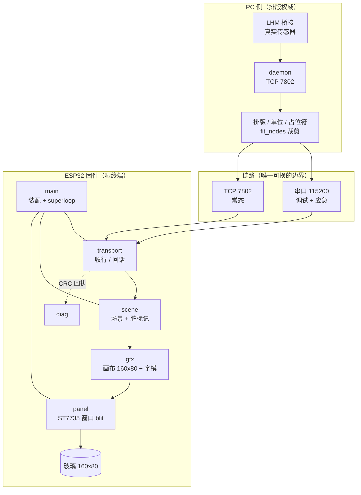
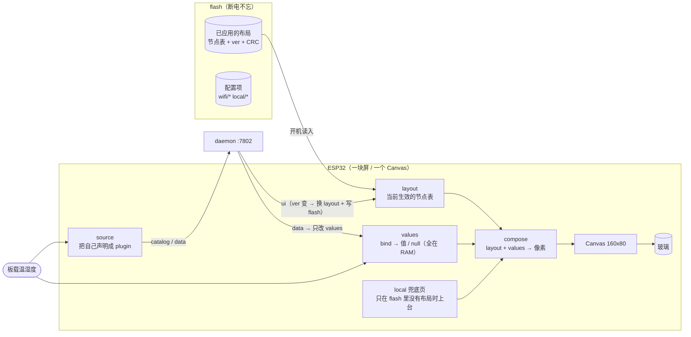

# 固件架构（单片机侧）

> 这份文档管**固件内部怎么分层、谁拥有什么、以后怎么长**。
> 协议语义在 `PROTOCOL.md`，PC 侧分工在 `TASKS.md`，这里不重复。

---

## 0. 一句话

**屏幕是哑的，排版权永远在 PC。** 板子只做四件事：把网络/串口来的字节攒成行、把行变成像素、把像素推上玻璃、把"我推了什么"报回去。

架构的全部难点不在画图，在这条线上：**输入（不可靠、会断）→ 场景（可重建）→ 像素（一次性、原子）**。中间任何一步都不许依赖上一步的历史。

---

## 1. 硬事实（不许在代码里"以为"）

| 项 | 值 | 影响 |
|---|---|---|
| MCU | ESP32（双核 240MHz，520KB SRAM） | 单核跑主循环，另一个核空着 |
| 框架 | `esp-hal 1.1.2`，`no_std`，`esp-bootloader-esp-idf 0.5` | 没有 RTOS、没有 `std`、没有 `println!` |
| 屏 | ST7735 160×80 横屏，RGB565 | `MADCTL=0x60`、偏移 `(0,24)`、不反相 |
| 全帧字节 | 160×80×2 = **25600 B** | 单缓冲直接吃掉 25KB 静态 RAM |
| SPI | 20MHz，阻塞式 | 全帧 `25600*8/20e6 ≈ 10.2 ms` |
| 字模 | 8×16，95 字，16 B/字 = 1520 B | 一行 20 字，共 5 行高 |
| 链路（阶段0） | UART0 115200 8N1，CH343 USB | 一行 ≤48 B，`\n` 结尾 |

> 10.2ms 这个数字是整个架构的标尺：**它决定了渲染只能在主循环里同步做，也决定了上 WiFi 之后必须让出 CPU**。

---

## 2. 目标 / 非目标

**要做到**

1. 换传输不掉一层皮：串口 → TCP 只换一个模块，`gfx`/`panel` 一行不改。
2. 换场景不掉一层皮：两行文本 → 协议节点树（`rect`/`text`/`num`）只换"场景"这一层。
3. 任何一环挂掉都能自证：断链、超长行、非法字节、CRC 不匹配、SPI 出错，全都**有编号、有计数、有串口输出**，且不把人卡死。
4. 内存账在编译期算清，不在运行期猜。

**明确不做**

- ❌ 不自己做任务编排（`esp-radio` 会带进 `esp-rtos` 的抢占式调度，那是给 WiFi 用的；我们的逻辑仍只存在于主循环，不开第二个应用线程）
- ❌ 不做双缓冲（要再 25600 B，1Hz 刷新下撕裂不可见）
- ❌ 不做 DMA SPI（10ms/帧够用；DMA 是帧率需求来了才做的事）
- ❌ 不在板子上做排版、单位换算、`--` 占位、指标语义（那是 daemon 的活）
- ❌ 不做 OTA（配网 UI 要做：AP 网页，见 §12）

---

## 3. 分层



> 这张图只回答一个问题：**谁在哪一层、边界在哪**。
> 判据：箭头跨越“链路”这条子图时，说明你在换传输；箭头在 `MCU` 内部横向走，说明你在改能力。

**规则（违反即架构腐化）**

- `gfx` 不知道 ST7735 存在，只知道"一块 `W×H` 的 RGB565 画布"。
- `panel` 不知道场景存在，只会 `init()` / `blit(&[u8])`。
- `scene` 不知道字节从哪来，只会被喂"已解析的一帧"。
- `transport` 不知道画什么，只提供 `read_line` / `write`。
- **只有 `main` 认识所有人**，也只有 `main` 持有 `&mut`。

模块与文件对应（阶段0 现状 → 阶段4）：

| 模块 | 现在（阶段1 已落地） | 阶段2 | 阶段3+ |
|---|---|---|---|
| `main` | `st7735-text/src/main.rs`（装配 + 单循环） | 同 | 同 |
| `board` | `st7735-text/src/board.rs`（引脚 + 实测参数） | 同 | 加 sensor / keys |
| `panel` | `st7735-text/src/panel.rs`（`St7735::blit_rect`） | 同 | 同 |
| `canvas` / 字模 | `panel-core/src/{canvas,font8x16}.rs` | 同 | 加 `rect`/`num`/`path` |
| `crc` | `panel-core/src/crc32.rs` | 同 | 可换查表版（同值） |
| `scene` | `panel-core/src/scene.rs`（`Rows`） | 同 | `Tree`（节点树）+ `Local`（兜底页） |
| `link` | `panel-core/src/link.rs`（trait + 退避）/ `st7735-text/src/link.rs`（`UartLine`） | 加 `TcpLink` | 同 + 重连 FSM |
| `diag` | `st7735-text/src/diag.rs` | 同 | 加 `stat` |
| `store` | — | `store_flash` + A/B 扇区 | 同 |
| `proto` | — | — | `panel-core/src/proto/` |

> 阶段1 的验收不是口头承诺：`panel-core` 在 PC 上 `cargo test` 跑 **14 个测试**，
> 其中 8 条是**逐字节 CRC 向量**（期望值由 `preview_st7735.py` 算出），
> 4 条把启动横幅与 `FRAME` 行的文本钉死。硬件侧只需把字节搬到玻璃上。

> 阶段1（重构）**不改变任何行为**：串口线格式、CRC、屏上画面必须逐字节不变，`check_parity.py` 仍 `PARITY OK`。重构没有验收对比就是重写。

---

## 4. 并发模型

### 阶段0–2：单线程 superloop

```rust
loop {
    match transport.poll(&mut line) {      // 非阻塞/短阻塞，绝不无限等
        Poll::Line(bytes)  => { scene.apply(bytes); }   // 只改状态，不碰像素
        Poll::Idle         => { wdt.feed(); }
        Poll::LinkLost     => { scene.link_lost(); backoff(); }  // 1/2/4/8/10s
        Poll::Error(e)     => { stats.err(e); }
    }
    if scene.is_dirty() {
        scene.render(canvas);   // 占满画布：clear + 画
        panel.blit(canvas.raw());
        diag.frame_crc(canvas.crc32());   // 报"我推了什么"
        scene.mark_clean();
    }
}
```

三条铁律：

1. **输入不画图，画图不读输入。** `scene.apply` 只写状态，渲染统一在循环尾部。以后加多页、焦点、动画，都只是 `scene` 内部的事。
2. **一次渲染 = 一整帧 = 一次 `blit`。** 绝不边算像素边推 SPI（会出现半帧、且 SPI 事务碎成几百次）。
3. **任何阻塞都有上限。** UART 读、TCP 收、`blit` 都是有限时长；没有"等到有数据"的忙等。

### 阶段2+：WiFi（`esp-radio` + `esp-rtos`）与主循环的关系（重点）

**版本事实（已实测，别再猜）**：`esp-wifi` 是上一代名字（停在 0.15，要 `esp-alloc 0.8`）。
对 `esp-hal 1.1.2` 正确的是 **`esp-radio 0.18.0`**（要 `esp-hal ~1.1.0-rc.0`、`esp-sync 0.2.1`），
它带进 `esp-rtos 0.3`（抢占式调度）与 `esp-alloc 0.10`。

一好一坏：

- **好**：WiFi 任务会被抢占调度，`blit` 那 10.2ms 饿不死网络栈——原先最担心的一条自动消失。
- **坏**：有抢占就有并发，跨线程共享的东西必须显式保护。

由此定两条：

1. **渲染仍然只在主循环里同步做**（不进 async task）。理由不是性能，是**可预测性**：渲染进 async 后"最长阻塞"就说不清了，`LINK LOST` 判定会飘。
2. **主循环与网络任务之间只有两个受保护的接口**：一个单槽 mailbox（网络 → 主循环，最新覆盖旧的）+ 一个发送槽（主循环 → 网络，只保最新）。除此之外**不共享任何东西**——不共享 Canvas、不共享 scene、不共享 buffer。

真要高帧率（>20fps）时再上 SPI DMA：`blit` 变成"启动 DMA → 让出 → 完成中断续跑"，那时才需要重新审这条。

---

## 5. 内存预算（编译期账本）

| 项 | 阶段0–1 | 阶段2（WiFi） | 阶段3（协议） |
|---|---|---|---|
| framebuffer | 25600 | 25600 | 25600 |
| 字模 | 1520（flash 常量） | 同 | 同 |
| 行缓冲 | 48 | 128 | 1024 |
| 收发 chunk | 64 | 64 | — |
| WiFi 静态缓冲 | — | ~30–40 KB | 同 |
| esp-alloc 堆 | — | 64 KB | 96 KB |
| JSON 解缓冲 | — | — | 8 KB（`max_json_bytes` 上限 4096 时够） |
| **栈（主）** | 8 KB | 8 KB | 12 KB |
| 余量 | 充裕 | 紧但可行 | 要盯 |

ESP32 可用 SRAM ≈ 320KB（扣掉 bootloader/ROM 预留）。阶段2 起总占用约 130KB，**余量够，但不许再随手加 25KB 级静态数组**——加之前先记账。

分配策略：**阶段0–1 全静态，不引 `esp-alloc`。** 阶段2 引入单一线性的 `esp-alloc` 堆，只给 WiFi 和 JSON 用，`gfx`/`panel` 永不 `malloc`。

---

## 6. 接口契约

```rust
// net/mod.rs —— 窄到只有两件事
pub trait Transport {
    /// 取一条完整行（不含 \n）。None = 暂时没有。Err = 链路断了。
    fn poll_line(&mut self, out: &mut [u8]) -> Result<Option<usize>, LinkError>;
    /// 回话（CRC 行、启动横幅）。部分写要循环写完。
    fn write_all(&mut self, bytes: &[u8]) -> Result<(), LinkError>;
    fn is_up(&self) -> bool;
}

// gfx/canvas.rs
pub struct Canvas { /* 160*80*2，单缓冲 */ }
impl Canvas {
    pub fn clear(&mut self, colour: Rgb565);
    pub fn put(&mut self, x: u16, y: u16, colour: Rgb565);        // 越界静默丢弃
    pub fn text(&mut self, x: i16, y: i16, s: &[u8], colour: Rgb565); // 8x16 单元
    pub fn rect(&mut self, x: u16, y: u16, w: u16, h: u16, colour: Rgb565); // 阶段3
    pub fn raw(&self) -> &[u8];
    pub fn crc32(&self) -> u32;   // 与 PC 的 zlib.crc32 同值
}

// scene/mod.rs
pub trait Scene {
    fn apply(&mut self, line: &[u8]);   // 吃原始字节，内部解析（阶段3 变成 JSON）
    fn link_lost(&mut self);
    fn is_dirty(&self) -> bool;
    fn render(&mut self, c: &mut Canvas);
    fn mark_clean(&mut self);
}
```

设计取舍：

- **`Transport` 用 trait，`Scene` 用 trait，`Canvas` 用具体类型。** 前者要能换实现，后者换实现没意义，泛型化只会把类型签名弄脏。
- `poll_line` 返回 `Result<Option<usize>>` 而不是 `impl Iterator`：`no_std` 里 iterator + lifetime 会让 `main` 的可读性崩掉，简单三态够用。
- `Canvas::crc32` 放在画布上，不放在传输层：**校验的是像素，不是字节。**

---

## 7. 状态机

```
      ┌────────┐  panel init ok   ┌──────────┐
 上电 →│  BOOT  │─────────────────▶│  READY   │   ← 屏黑 + 串口 "READY"
      └────────┘                  └────┬─────┘
                                       │ 收到第一帧
                                  ┌────▼─────┐  无数据 15s
                                  │ STREAMING │──────────▶ ┌───────────┐
                                  └────┬──────┘            │ LINK_LOST │
                                       │ 收到数据           └─────┬─────┘
                                       │◀──────────────────────────┘
```

- `LINK_LOST` 的判据与 PC 侧一致（`term_tk.py` 的 15s，协议 §13.5）：**板子和桌面终端对"掉线"用同一个阈值**，不各说各话。
- `LINK_LOST` 时屏上画 `LINK LOST`（板子唯一允许自己画的内容之一，另一个是启动横幅）——因为此时 PC 已经指望不上了，这条信息只能由板子给。
- 重连退避 **1/2/4/8/10s 封顶**，与 `pcmon/lhm.py` 的阶梯一致。

---

## 8. 失败模式表（每条都要有编号）

| # | 现象 | 触发 | 处理 | 自证 |
|---|---|---|---|---|
| F1 | 行超长 | >`LINE_MAX` | 丢整行，重新攒 | `E1 drop=overlong n=` 计数 |
| F2 | 非法字节 | 非 ASCII/控制符 | 该字节存 `?`，行照收 | `E2 badbyte` 计数 |
| F3 | 一帧都没画 | 收到空行 | 清屏即可，不算错 | — |
| F4 | CRC 不匹配（PC 侧发现） | 字模/几何不一致 | 板子**继续跑**，PC 报警 | `PARITY FAIL` 由 PC 报 |
| F5 | SPI 写失败 | 硬件/时钟 | 计数，重试一次 `blit`，再失败就重 init 面板 | `E5 spi` 计数 |
| F6 | 链路无数据 15s | 拔线/断电/包漂 | `LINK_LOST`，屏上明示 | 屏 + 串口 |
| F7 | WiFi 断开（阶段2） | 路由/密码/信号 | 退避重连，屏上 `LINK LOST` | 串口日志行 |
| F8 | JSON 超预算（阶段3） | daemon 发太大 | 整帧丢弃，保留上一帧画面，计数 | `E8 json` 计数 |
| F9 | 看门狗 | 死循环/阻塞 | 复位 | 启动横幅带 `reset_reason` |
| F10 | 面板初始化失败 | 接线/供电 | 屏黑但串口持续报 `E10`，不静默 | 串口 |

**共同要求**：板上 panic handler 绝不能是现在的空 `loop {}`。阶段2 起它必须能在复位前吐一行到串口（UART 提前抢过来、寄存一份），否则"屏黑了"永远只能靠猜。

---

## 9. 演进阶段与验收

| 阶段 | 内容 | 验收（可执行） | 不该动的东西 |
|---|---|---|---|
| **0（现状）** | 串口哑终端，两行文本，CRC 回执 | `check_parity.py` → `PARITY OK`；`live_serial.py` 每帧 `ok` | — |
| **1 重构** | 按 §3 拆模块，抽 `Transport`/`Canvas`/`Scene` | **同上，且 CRC 值逐个不变**（同一输入 → 同一 `crc=0x...`） | 线格式、画面、字模 |
| **2 依赖通关 + 配网** | 先只加依赖不写业务（`esp-radio 0.18` / `esp-alloc 0.10` / `embassy-net 0.9.1` / `picoserve 0.20` / `esp-storage 0.9`）跑通 build；再做 AP 网页配网 + sector store + 连上打一行 `WIFI up ip=...` | 手机上能看到配网页、填密码→重启自动连上、串口出 IP；**连不上 30s 自动回热点**；断电不丢密码 | `gfx`/`panel`/`scene`/`gfx` 一行不改 |
| **3 协议子集 + UI 持久化** | `hello` + `ui`/`data` over TCP 7802，画 `rect`/`text`/`num`/`path`；**`ver` 变才重建并写 flash** | 与 `term_tk.py` **同源同画面**；**拔电重开，布局还在、值全是 `--`**；`ver` 变小也能更新；`fit_nodes` 裁剪后不超 | 同上 + 阶段2 的串口调试通道 |
| **4 折线** | `line` 节点 + 设备端环形缓冲（协议 §8）+ 局部窗口刷新 | 数值与任务管理器对得上；**拔掉 PC 后曲线不消失**；单次 blit ≤ 4ms | `scene` 之外的层 |
| **5 设备当数据源** | 第二条连接当 plugin（source plane） | 装插件后 `catalog` 多出 `sensor.*`，同一块屏能把它们绑进页面 | 显示路径 |
| **6 兜底页** | flash 里没有布局时的本机页（未配置提示 + 设备信息） | 清掉配置开机 → 看到兜底页；写入布局后自动让位；不再跟 render 抢屏 | 同上 |

阶段1 是唯一"没有新功能"的阶段，也是最值钱的：**它把后面几次换血变成改一个文件。**

阶段2 是整个项目最重、风险最高的一块（WiFi 栈 + flash + HTTP + 超时交互），
但它也是唯一一块可以**独立失败**的：失败了，阶段0/1 的串口屏照样能用。
所以它必须排在协议之前，不能和协议混在一起做。

---

## 10. 决策记录（为什么这样，不那样）

| # | 决策 | 理由 | 什么时候该推翻 |
|---|---|---|---|
| D1 | 排版/语义全在 PC（**限于 render plane**） | 与 M6「终端零语义」同一条规矩；改样式不用重烧固件 | 已部分推翻：local plane 的排版在固件里（§12）。两个面各管各的，**不复用布局代码** |
| D2 | 单缓冲（RAM 里始终是完整 160×80），但**推屏可只推脏矩形** | 双缓冲要多 25KB 却买不到什么；RAM 全幅是 CRC 自证的前提；局部推屏把折线的 SPI 时间从 10.2ms 降到 ~3ms | 需要整屏淡入淡出/位移动画时 |
| D3 | 阻塞 SPI（先 20MHz，可试 40MHz） | 局部刷新后单次 ≤4ms，10Hz 占空比也不到 5%；DMA 那层复杂度现在买不到东西 | 实测刷新跟不上，或要 >20fps |
| D4 | 阶段0–1 零堆分配 | `no_std` 里静态数组可被链接器核算，堆不能 | 上 WiFi（强制） |
| D5 | CRC32 先 bitwise | 与 `zlib.crc32` 逐位同构，好核对 | 现在就能换查表版（同多项式同结果，仍 4 字节内自证），省 ~8 倍时间 |
| D6 | 渲染留在主循环，只把收包 async 化 | 保证"最长阻塞"可预测，`LINK LOST` 判定不飘 | 上 DMA + 高帧率 |
| D7 | `LINK LOST` 由板子自画 | 链路断了只有板子能说话 | 永不需要 |
| D8 | 保留串口做常驻调试口（阶段2 之后） | 屏黑了、网断了，只剩串口能自证 | 需要省引脚时（可留 TX-only） |
| D9 | **折线历史放在设备端**（协议 §8） | 带宽从 ~1KB/s 降到几十字节/s；断线曲线不消失；PC 不用维护历史 | 永不需要（协议既定） |
| D10 | 设备要当数据源，就走"**第二条连接当 plugin**"，不自造包头 | 未知 `t` 只会被**静默忽略**（§20），不会"变出"元素；而 plugin 连接是协议里**已经存在**的位置（§6 catalog 汇总、§16 插件注册表） | 永不需要 |
| D11 | 三个面共用一块 Canvas、一个 `Scene` trait | 差别只在占有权和数据来源，不做两套绘图代码 | 本地面需要截然不同的渲染路径时（不该发生） |
| D12 | 连不上路由器 30s **自动开热点** | 无按键设备的唯一自救路；否则改一次密码 = 变砖 | 加了物理按键/编码器之后（仍建议保留作兼底） |
| D13 | 帧 CRC 保持覆盖**整幅** 160×80，即使只推局部窗口 | 校验的是 RAM 里的像素、不是线上字节；局部刷新不能让"自证"失效 | 永不需要 |
| D14 | **画面 = 持久布局 + 易失值表**，屏只有一个主人 | 消掉三面争屏；开机不黑；掉线不清屏；只有"应用"才换布局 | 永不需要 |
| D15 | flash 存**二进制节点表**，不存 JSON 原文 | 开机不用跑解析器；体积差 4 倍；半写靠 `ver`+CRC 兜 | 节点数不定/要存任意字符串时 |
| D16 | 板载指标用 `local.*`，**本地优先**，PC 同名 `data` 丢弃 | 一个 bind 只能有一个来源，否则屏上两个值打架 | 需要 PC 远程覆盖/校准本地值时（那时加显式 override 字段） |

---

## 11. 已定（原先的四个待定，已拍板）

| # | 问题 | 决定 | 直接后果 |
|---|---|---|---|
| 1 | 目标形态 | **两面并存**：串口常驻当调试口，WiFi 常态运行 | 阶段2 必做；串口永不删 |
| 2 | 要不要曲线 | **要折线** | 推翻"整帧推"→ 改脏矩形推屏；折线历史在设备端（D9） |
| 3 | WiFi 凭据怎么进 | **首次启动 AP 网页配网** | 必引 flash 存储 + HTTP server；连不上 30s 自动回热点（D12） |
| 4 | 按键 | **暂时不做** | `event` 通道留接口不实现；本机面只能只读（§12） |

⚠️ 第 3、4 条联动出一个必然结论：**没有按键的设备，配网入口只能是"连不上就开热点"和串口命令**。
这两条都得在固件里，否则用户改一次路由器密码，这块屏就永久失联。

---

## 12. 三个面（不是内外层，是并列的三个面）

「内外层」这个说法其实不准确：它们不是嵌套关系，而是**同一块屏上并列的三个"面"**，
差别只在"数据从哪来、谁说了算"。

| 面 | 谁驱动 | 数据流 | 没 PC 时能否工作 |
|---|---|---|---|
| **saved plane**（常驻布局） | 最后一次「应用」的 ui，存在 flash | flash → 玻璃 | ✅ |
| **render plane**（配置通道） | PC 的 daemon | 新 ui（`ver` 变才重建） | ❌ |
| **local plane**（兜底 + 供数） | 板子自己 | 板载传感器 / 设备信息 | ✅ |
| **source plane**（数据源） | 板子自己 | 板载传感器 → daemon → 所有终端 | ✅（但别人在线才看得到） |



### 核心公式（这一章其他内容都是它的推论）

```
玻璃上看到的东西 = 布局（持久、只在「应用」时换） + 值（易失、随时变、null 画 --）
```

这句话把原来"三个面争一块屏"的矛盾直接消掉了：**屏永远只有一个主人（当前生效的 layout）**，
三个面各自干自己的活：

- `saved` 负责"开机不黑" —— 布局存在 flash，开机就有画面
- `render` 负责"换布局" —— 只在 PC 点「应用」时发生
- `local` 负责"没布局时的兜底" —— 仅当 flash 里没有可用布局
- `source` 负责"板载指标也进 catalog" —— 跟显示解耦

### 开机时序（你描述的那个画面）

| 时刻 | 屏上 | 原因 |
|---|---|---|
| 上电 0.2s | 读出 flash 布局，画出骨架 | 布局持久化 |
| 立刻 | `温度 30C 湿度 60%` 有数 | **板载传感器直接填 values**，不等网 |
| 立刻 | `CPU --` `TEMP --` | 数据永不写 flash（协议 §13），没网就是 null |
| 联网后 1s | daemon 重发 `ui` + `data`，`--` 变成真值 | 协议 §16 红线4（无条件重发） |
| 网断了 | 数值逐步变 `--`，角标 `LINK LOST` | 协议 §9 / §13.5；**布局不消失、不清屏** |
| 从未配过 | 本地兜底页（“未配置 / 连 Wi-Fi”） | 否则黑屏像坏了 |

### `ver` 的语义（这里最容易写错）

| 规则 | 说明 |
|---|---|
| `ver` 是**已应用配置**的版本，不是每次改都 +1 | 编辑器里拖拖拽拽不产生新 `ver`；点「应用」才 +1 |
| 板上用 `!=` 判断，**不能用 `>`** | PC 回滚、或换了一台 PC、或重装 daemon，`ver` 都可能变小；用 `>` 就永远不更新 |
| 只写 flash，不写数据 | 且一次应用只写一次（天然节流，不用额外做限流） |
| 写失败不能砸屏 | 先写新扇区并校验 CRC，通过后才切换指针；失败则继续用旧的 |

### ⚠️ PC 侧必须配合的一件事

PC 端要区分**草稿**和**已应用**：编辑器里改完不点「应用」，板上不变。
而且：**daemon 重启后重发（§16 红线4）必须发"已应用的那份"，不能发草稿。**
否则用户只是拖了一下没点应用，重启 daemon 就把草稿推上屏了。

这意味着 PC 侧的"已应用配置"也要持久化——那是 daemon 的活，但界线和固件这边要对齐，
否则两边对 `ver` 的理解会慢慢分叉。

### flash 里存什么（不要存 JSON）

| 存 | 不存 |
|---|---|
| 布局的**二进制节点表** + `ver` + `CRC` | ❌ 不存 JSON 原文（开机要跑解析器，且占 4 倍空间） |
| 配置项（wifi/cmd/local） | ❌ 不存任何 `data` 值 |
| 可选：每个 `line` 节点的环形缓冲（不存也行） | ❌ 不存 Canvas 位图（25600B，且与布局冗余） |

预算：32 个节点 × 24B ≈ 768B，比挂一个 JSON 解析器便宜得多。

### 跨面的 bind：一个值只能有一个来源

`sensor.temp` 这种指标，既可能来自 daemon 的 `data`，也可能来自板载传感器。
**必须定一个优先级，否则两个值会打架、屏上跳。** 规则：

| 指标来源 | 命名空间 | 谁填 | PC 送同名 `data` 怎么办 |
|---|---|---|---|
| 板载传感器 | `local.*`（建议） | 板子每 N 秒自己填 | **丢弃**（本地优先，避免两处争一个 bind） |
| PC/daemon | 其他（`cpu.*` / `sensor.*`…） | daemon 的 `data` | 正常覆盖 |

> 板载指标在 `catalog` 里也要声明（`source:"local"` 类字段，老 daemon 会当未知字段忽略，不影响兼容），
> 这样 PC 才知道这些指标不用它供数、但可以绑进页面。

### 删元素 ≠ 删数据源

在 PC 上把 `CPU` / `TEMP` 两个节点删掉 → 点应用 → 板上就只剩温湿度。
但 `cpu.total` 这个指标**还在 catalog 里、daemon 照旧每帧发**，只是没人画它。
这两件事必须是独立的，否则"删一个元素"会连带把别的页弄坏。

### 本机面（local）现在只剩两件事

1. **兜底页**：flash 里没有可用布局时（首次开机 / CRC 损坏 / 用户手动清了配置）
2. **供数**：把板载传感器填进 `values`

它**不再跟 render 抢屏**。原来那套"PC 不在就夺屏、60s 后切本地"的规则作废——
你这条决定把那个冲突点直接删掉了，架构反而更简单。

- ✅ 兜底页内容：`未配置` + 热点名 + IP + RSSI + uptime + 复位原因 + 固件版本 + MAC
- ❌ 依然不能改设置：**没有输入设备**（改密码靠手机连热点开网页 / 串口命令）
- ⚠️ 想在屏上做菜单，必须先有按键/编码器 —— 见 §14

> 所有面**共用一块 Canvas、一条 blit 路径**。`layout` 和 `local` 都产出"要画的节点"，
> 只是节点来源不同。一旦你开始为 local 单写一套渲染，这个设计就死了。

---

## 13. 扩展位清单（现在留，以后填）

这是"挂个传感器就变成 UI 元素"那套设想在**代码里该占的位置**。现在不实现，但结构必须留出来，
否则以后是重写而不是扩展。

| # | 现在留什么 | 以后填什么 | 不留会怎样 |
|---|---|---|---|
| E1 | `Scene` trait（`saved` / `local` 两个来源） | 兜底页 | 必然写成 if/else 揉进主循环 |
| E2 | `Transport` trait 的第二个实例 | source plane 的第二条连接 | 重连退避/超时逻辑要写两遍 |
| E3 | `store` 做成**通用 key-value**（不是 wifi-only） | `wifi/*`、`local/*`、`ui/cache` 共用 | 加一个 key 就要重写一遍 flash 代码 |
| E4 | `Sensor` trait + cargo feature 开关 | 温湿度、气压、光照…… | 不用的驱动全进 flash；且没有统一的数据形状 |
| E5 | `Scene::tick(now_ms)` 时间钩子 | 折线滚动、兜底页里的 uptime/IP 刷新 | 这两件事以后无处安放 |
| E6 | `panel.blit_rect(x,y,w,h)` 接口（现在按整屏调用） | 折线/文本的局部刷新 | 到时候要改穿整个渲染链 |
| E7 | 帧 CRC 覆盖**整幅**（不随局部推屏改变） | 不动 | "自证"机制作废，回到"看着像" |

### 你说的那个"开关 + 插件"，正确形态是两条开关

1. **编译开关**（cargo feature）：`--features sensor_sht3x` —— 决定驱动**在不在固件里**（省 flash）
2. **运行开关**（存 flash 的配置项）：`source.enabled = false` —— 决定**发不发包**（不装插件就不发）

然后这条链是通的：

```
板上挂传感器
  → 固件开 feature + 打开运行开关
  → 板子开第二条连接，以 plugin 身份连 daemon，发 catalog(sensor.temp/sensor.rh) + data
  → daemon 汇总 catalog（§6：插件接入 → catalog 变化 → 必须重发）→ 所有终端自动看到新指标
  → PC 上把 num/line 节点 bind 到 sensor.temp，放进任意一页（页面归 PC 管，§10）
```

**这条路径上一个字节都不是"协议之外"的**——这正是它比"自己发个包"强的地方。
未知 `t` 会被**静默忽略**（§20），你辛辛苦苦发的包不会变成 UI 元素，只会消失；
而 plugin 连接是协议里**早就存在**的位置。

### 不许做（会把上面七个位全作废）

- ❌ 自造包头 / UDP 广播绕开协议
- ❌ 让 daemon 遇到未安装的插件就断链（必须是"贡献指标 / 静默忽略"，不是报错）
- ❌ local plane 直接碰 Canvas（必须过 `Scene`）
- ❌ 在 source 连接上发 `ui`（数据源只说数据，不说布局）
- ❌ 两条连接用同一个 `client_id`（协议 §16 红线5 会踢掉旧连接，等于自己踢自己）

---

## 14. 已定参数（原待定，已拍板）

> 具体到"一个新板子该怎么写"，看 **`firmware/SPEC.md`**（设计规范，MUST/SHOULD 那种）。
> 本文说"为什么这么分层"，SPEC 说"每一层必须长什么样"。

| # | 参数 | 定值 | 理由 |
|---|---|---|---|
| 1 | 单值超时阈值 | `interval_ms × 3` | 与 `pcmon.protocol.is_stale(factor=3.0)` 同一个数；两边各定一套必然对不上 |
| 2 | 节点上限 | **32 个** | 32×24B ≈ 768B，一屏 20×5 字符也塞不满 32 个节点；超了 daemon 那边 `fit_nodes` 就该裁 |
| 3 | 板载指标命名 | **`local.*`**（`local.temp` / `local.rh`） | 跟"本地采集"这个机制同义，不是"环境量"这个物理意义；将来 `local.battery` 也放得下 |
| 4 | I2C 引脚 | **GPIO21=SDA / GPIO22=SCL**（写死在 `board.rs` 注释里占位） | ESP32 默认 I2C 脚，不跟 SPI（18/23/5）和 UART（1/3）碰 |
| 5 | 折线两点之间 | **连线**（直线段，不插值、不平滑） | 协议 §21 写明贝塞尔是后续；现在先跟 `path` 的语义一致 |
| 6 | 按键 IO 预留 | **GPIO32 / 33 / 25 / 26**（KEY1–KEY4，暂不实现） | 这四个都能内部上拉、不碰 strapping 脚，也不跟 SPI(18/23/5/4/15/2)、UART(1/3)、I2C(21/22) 冲突；34–39 是 input-only 且无内部上拉，不用 |

### 真正还没定的只剩一个

**要不要留一个物理键/编码器？** 它决定两件事：本机面能不能有菜单（现在只能只读兜底页）、以后能不能切页。
不影响阶段1–3 的任何代码，可以最后再定。
